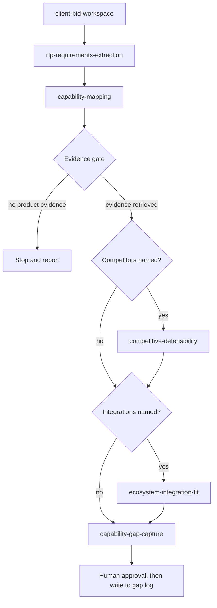

# Bid Analyser

A vendor-neutral, skills-based AI agent kit that helps product managers assess RFPs, RFIs and seller-drafted bids against what their product can actually prove it does.

It is a set of prompt and skill definitions with two small Python helpers. It isn't an application. You load it into any agent platform that supports system instructions, skills and file tools.

## Why this exists

Bid responses often fail in the same ways. Sellers over-commit, capabilities are claimed without evidence, integrations are promised that nobody has verified, and the same product gaps lose deal after deal without anyone counting them.

This kit enforces an **evidence-first** workflow:

- Only your official product documentation can prove a capability.
- Every "Meets" needs a citation. No citation means "Needs Evidence".
- Web research is allowed, but always flagged and never used in response wording.
- Gaps are logged only after a human approves them, so the log is trustworthy product evidence rather than a commitment.

## Two modes

| Mode | Input | Goal |
|---|---|---|
| **A – Customer RFP/RFI** | Procurement documents your company must answer | Fit, gaps, risks, response priorities |
| **B – Seller bid review** | A bid drafted by a seller | Catch over-commitments, wrong licensing and unsupported claims before it goes out |

## Pipeline



## Repository layout

```
bid-analyser/
├── agent/
│   └── instructions.md              # Master system prompt (modes, source hierarchy, rules, final answer format)
└── skills/
    ├── client-bid-workspace/        # Workspace naming and filing plan
    │   ├── SKILL.md
    │   └── scripts/main.py
    ├── rfp-requirements-extraction/ # Requirements register, evaluation model, mandates
    │   └── SKILL.md
    ├── capability-mapping/          # Requirement-to-capability fit, with citations
    │   └── SKILL.md
    ├── competitive-defensibility/   # Evidence-backed differentiators, trap questions
    │   └── SKILL.md
    ├── ecosystem-integration-fit/   # Integration mechanism, licence and effort per hop
    │   └── SKILL.md
    └── capability-gap-capture/      # Approved, deduplicated cross-bid gap log
        ├── SKILL.md
        └── scripts/gap_log.py
```

## Skills at a glance

| Skill | Runs | Output |
|---|---|---|
| `client-bid-workspace` | Always, on new documents | Canonical workspace name and folder plan (`01 - Intake` to `99 - Archive`) |
| `rfp-requirements-extraction` | Always | `Requirements Register.xlsx` with Evaluation Model, Compliance Mandates, Mentions and Key Dates tabs |
| `capability-mapping` | Always | `Capability Map.xlsx` with classification, delivery route, citation and confidence |
| `competitive-defensibility` | Only if competitors are named or requirements look competitor-shaped | `Competitive Defensibility.docx` |
| `ecosystem-integration-fit` | Only if integrations are named | `Integration Fit.xlsx` |
| `capability-gap-capture` | Always last, or on demand ("log a gap") | `Capability Gap Log.xlsx` and a CSV for your roadmap tool |

## Classification model

Every requirement gets exactly one label:

- **Meets**: cited from product documentation.
- **Partially Meets**: states what is missing.
- **Gap**: not supported, or roadmap only.
- **Needs Evidence**: plausible, but no citation found.
- **Needs Clarification**: the requirement is ambiguous.

Each label carries a confidence rating: High (cited), Medium (reasoned from cited facts) or Low (assumption, with what would resolve it).

## Setup

1. **Pick an agent platform** that supports a system prompt, skills (or equivalent tools) and file access. Code-interpreter and document-search capabilities are assumed by the skills.
2. **Replace the placeholders.** In [`agent/instructions.md`](agent/instructions.md) and the skills, replace `<PRODUCT>` and `<VERSION>` with your product name and the documentation version you assess against.
3. **Load your knowledge.** Add the following to the agent's knowledge:
   - Your product's reference files or documentation export for that version.
   - A **Claims Register**: a table of approved differentiators and integrations, each marked `Verified`, `Unverified` or `Rejected`.
   - Any licensing, pricing and approval rules.
4. **Define your capability taxonomy** in [`skills/capability-mapping/SKILL.md`](skills/capability-mapping/SKILL.md). It ships as a placeholder.
5. **Register the skills.** Add each `skills/<name>/` folder to your agent. Keep the `scripts/` folders next to their `SKILL.md`.
6. **Adapt the export** in `capability-gap-capture` to your roadmap or idea-management tool's import format.

## Helper scripts

Both scripts use only the Python 3 standard library and read JSON from stdin.

**Filing plan:**

```bash
echo '{"client": "Example Corp", "files": ["Example RFP v2.pdf", "Addendum 1.pdf", "Requirements matrix.xlsx"]}' \
  | python3 skills/client-bid-workspace/scripts/main.py
```

Returns the workspace name, the subfolder list, file-to-folder assignments, warnings (unclassified files, duplicates) and a `complete` flag.

**Gap deduplication:**

```bash
echo '{"existing": [{"gap_id": "G001", "need": "Single sign-on with SAML"}],
       "new": [{"req_id": "R12", "need": "Support SAML single sign-on"}],
       "threshold": 0.45}' \
  | python3 skills/capability-gap-capture/scripts/gap_log.py
```

Returns, for each new gap, either `merge` into an existing Gap ID or `new` with the next ID, plus a similarity score. The score is a hint only. A person confirms each merge.

## Design principles

- **Evidence over assertion.** Seller claims, file names, metadata, previous analyses and model knowledge are never proof.
- **Fail closed.** If product evidence can't be retrieved, the analysis stops instead of guessing.
- **Human approval.** Nothing is written to the gap log without explicit approval. No gap is ever promised or dated.
- **Confidentiality.** Summaries say "the customer". Quotes are capped (25 words in analysis outputs). Client names never appear in roadmap exports.
- **Not a decision-maker.** Legal, contractual, security and pricing conclusions are inputs for review, not approvals.

## Known limitations

- The kit ships no product knowledge. Output quality depends entirely on the documentation and Claims Register you supply.
- The filing script routes by filename keywords, so ambiguous names land in `UNCLASSIFIED` for a person to resolve.
- Similarity matching in `gap_log.py` is token-based (Jaccard). It won't catch synonyms.
- Quote limits differ by stage (25 words in capability analysis, 40 in extraction and the gap log's original-wording field). Align them to your confidentiality policy.

## Contributing

Issues and pull requests are welcome, especially:

- Capability taxonomies for other product categories.
- Claims Register templates.
- Adapters for specific agent platforms and roadmap tools.

## Licence

Released under the [MIT License](LICENSE).
